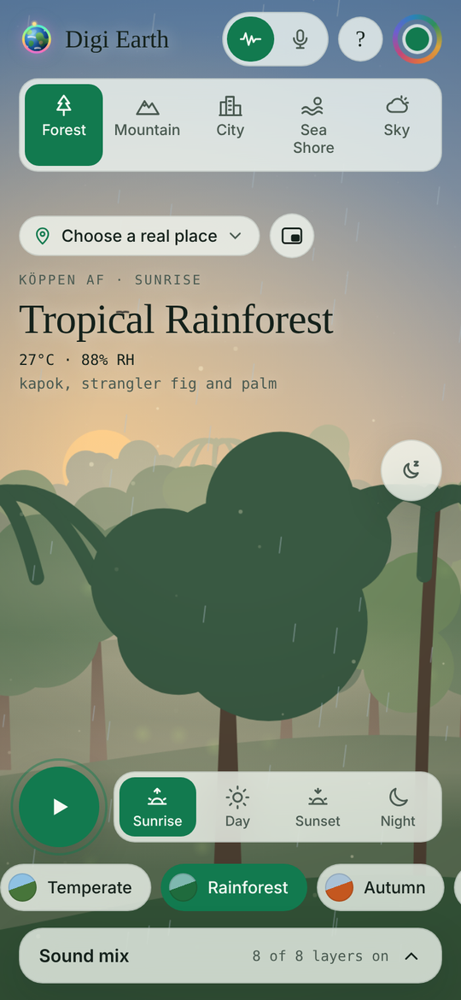
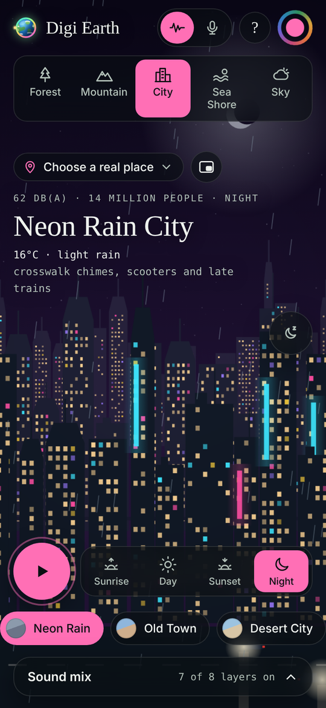
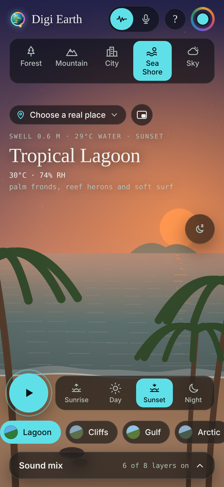
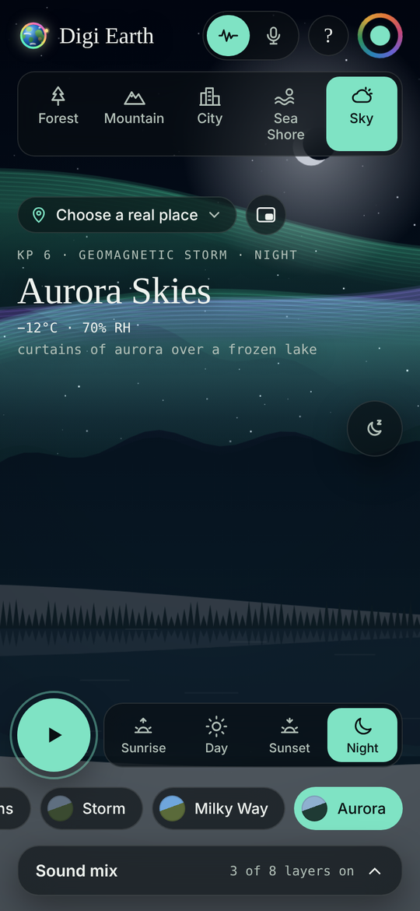

# Digi Earth

A calm, living window onto the planet. Digi Earth is an ambient soundscape web app with animated forests, mountains, cities, shores and skies. Set the hour from sunrise to night, visit real places around the world, and listen to ambience that is either generated live or recorded in the field.

Created by **SSK-BLUM**.

<p>
  
  
  
  
</p>

## Features

- **5 worlds, 31 scenes**: Forest, Mountain, City, Sea Shore and Sky, each drawn live on a canvas with weather, wildlife and parallax.
- **Time of day**: Sunrise, Day, Sunset and Night change the light, the sky, the sound mix and the app's light or dark theme.
- **80 real places**, including 11 in Kerala, with region filters. *Match local time* follows each place's real clock.
- **Two sound modes**: *Electronic* generates every sound live with the Web Audio API. *Original* plays real field recordings.
- **Sound mixer** with 8 layers per world, a master volume and a sleep timer that fades the sound out.
- **Background playback**: lock-screen controls with scene artwork, plus a picture-in-picture mini player where supported.
- **Installable PWA** that works offline after the first visit.
- **Android app** built automatically by GitHub, with lock-screen media controls, background playback and picture-in-picture.
- Accent colour picker, a built-in "How to use" guide with spotlights, and support for reduced motion.

## Run it

It is a static site with no build step and no dependencies.

```bash
# from the project folder
python3 -m http.server 8000
# then open http://localhost:8000
```

Opening `index.html` straight from disk mostly works, but the offline service worker and the original recordings need a web server.

## Publish on GitHub Page

 Digi Earth Live `https://soorajacontec.github.io/digi-earth/`.
 

## Project structure

```
index.html            the whole app: markup, styles and script
manifest.webmanifest  PWA name, colours, icons and screenshots
sw.js                 service worker for offline use
icons/                app and home-screen icons
sounds/               15 looped field recordings (MP3)
fonts/                bundled fonts, so the app works offline
screenshots/          images used in this README and the install dialog
android/              Android app project (WebView wrapper, notification, PiP)
.github/workflows/    automatic Android build
```

When you change `index.html`, also bump `VERSION` in `sw.js` (for example from `digi-earth-v6` to `digi-earth-v7`) so installed copies pick up the update.

## Credits and licences

The code is released under the MIT License (see `LICENSE`).

The sound recordings come from other people and keep their own licences. See [`CREDITS.md`](CREDITS.md) for the full list and attribution.
